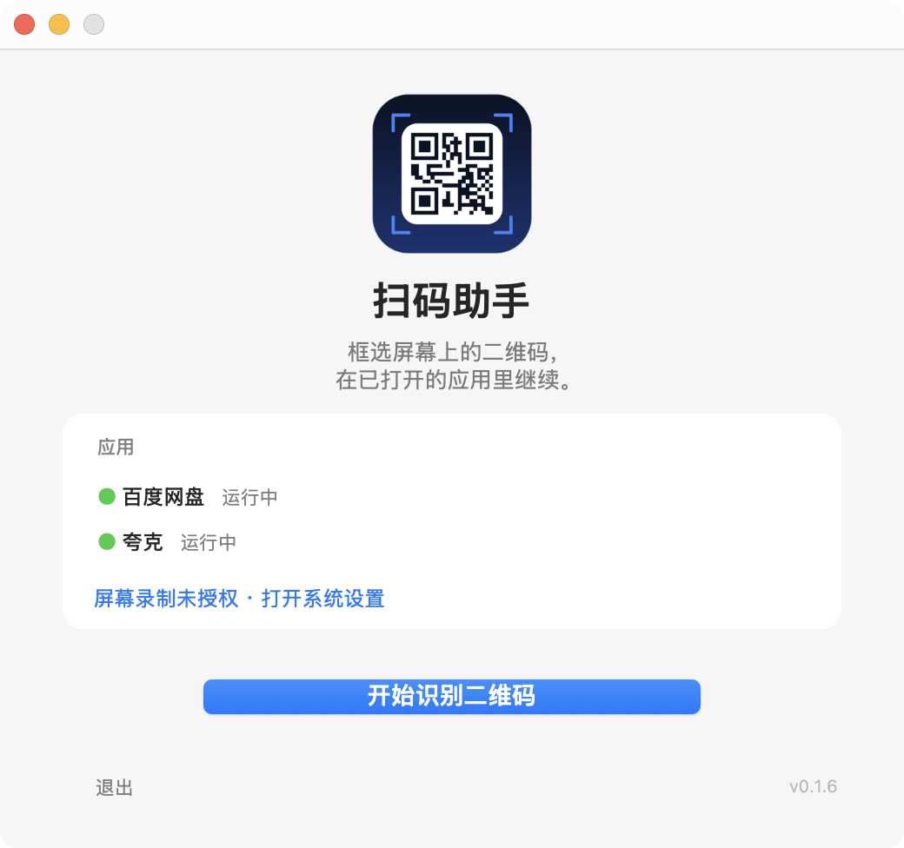
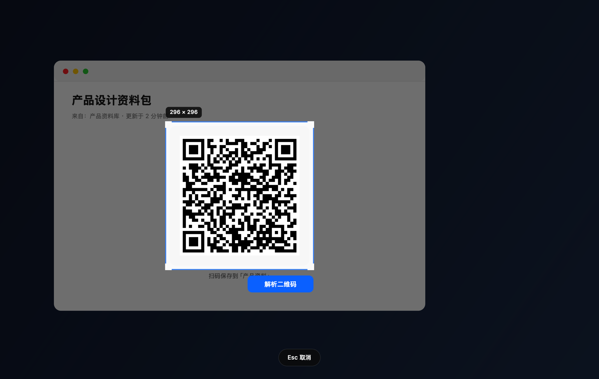
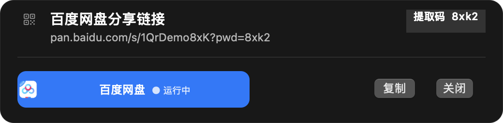
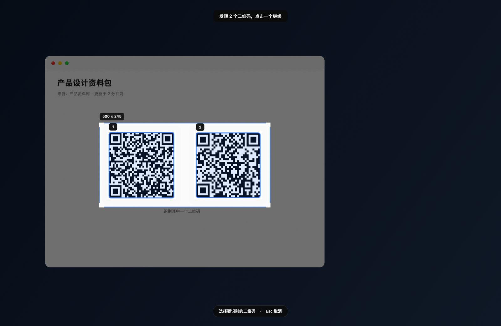
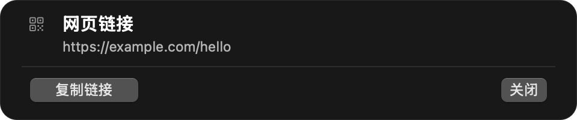

# 扫码助手（工作名 ScanCode）

PC 网页上出现网盘二维码时，按 `⌃⌥Q`（Windows 为 `Ctrl+Alt+Q`）框选 → 本地解析 → 唤起**已经打开**的百度网盘/夸克 → 保存由你在官方客户端里完成。

## macOS：直接打开

1. 打开 [GitHub Releases](https://github.com/M-adrigal/ScanCode/releases/latest) 下载 DMG
2. 把「扫码助手」拖到 **Applications**
3. 打开 Applications 里的「扫码助手」
   （如果之前在 DMG 里打开过，先在菜单栏退出旧实例，再打开 Applications 里的）
4. 如果 macOS 提示“无法验证开发者”：右键 App → **打开**
5. 首次使用按提示允许「屏幕录制」
6. **先手动打开百度网盘 / 夸克**，按 `⌃⌥Q` 框选二维码，再点「解析二维码」

打开后会看到这个欢迎窗口：



关闭欢迎窗口后 App 仍常驻菜单栏，可点菜单栏的二维码图标重新打开；从启动台再次打开也会重新显示欢迎窗口。

识别后只显示匹配的应用：百度链接只出现「百度网盘」，夸克链接只出现「夸克」；其他网页/文本二维码会显示解析后的完整地址，点「复制链接」再复制。选区内有多个二维码时，会显示 1/2 编号，需要再点一次要识别的那一个。

### 屏幕录制授权不生效？

macOS 会把授权记录绑在 App 的身份上，删掉 App 不会自动删掉旧记录。0.1.6 在每次未授权启动时会先执行
`tccutil reset ScreenCapture com.yuanye.scancode` 清理旧记录，再重新请求系统授权。

App 启动时会做一次实际截屏自检；如果开关看起来是开的但截屏失败，会自动清理旧授权并重新请求。
如果系统设置里仍能看到旧的「扫码助手 / ScanCode」条目但授权不生效：选中旧条目点减号删除，再重新打开 App。
如果仍不行：点菜单栏图标 →「修复屏幕录制权限…」。
每次覆盖安装新的 ad-hoc 构建，首次打开可能需要重新授权一次。

诊断日志：`~/Library/Application Support/ScanCode/ScanCode.log`（只记录事件，不记录二维码内容）。

### 界面

| 框选 | 结果条（只显示匹配应用） | 多个二维码二次选择 |
|---|---|---|
|  |  |  |

其他二维码会显示完整地址和「复制链接」，不显示网盘应用：



## Windows：直接打开

1. 打开 [GitHub Releases](https://github.com/M-adrigal/ScanCode/releases/latest) 下载 `ScanCode-win-x64.zip`
2. 解压后双击 `ScanCode.exe`，自带 .NET 运行时，不需要另装东西
   （Windows 10 22H2+ / Windows 11，x64）
3. 如果弹出「Windows 已保护你的电脑」：点「更多信息」→「仍要运行」（exe 未签名，属正常现象）
4. **先手动打开百度网盘 / 夸克**，按 `Ctrl+Alt+Q` 框选二维码，点「解析二维码」，再点应用按钮

构建方法、常见问题与已知限制见 [windows/README.md](windows/README.md)。

## 当前状态

- **macOS v0.1.6 已发布**（DMG）
- **Windows v0.1.6 已发布**（`ScanCode-win-x64.zip`，源码在 `windows/`，C# / .NET 10 / WPF）
- 安装包见 [GitHub Releases](https://github.com/M-adrigal/ScanCode/releases/latest)
- macOS 源码与开发说明：[macos/README.md](macos/README.md)
- Windows 源码与构建说明：[windows/README.md](windows/README.md)

## 三条约束

1. **v1 只唤起，不冷启动**：应用没打开就提示，工具不启动应用。
2. **只打开，不保存**：不自动保存/转存/下载，保存按钮由你在官方客户端点。
3. **全本地**：截图和二维码内容不上传、不落盘、不留历史。

## 已确认

- 平台：macOS 14+；Windows 10 22H2 + Windows 11（x64）
- 分发：自用/开源，不强制签名；Windows 可申请 SignPath Foundation 免费签名
- 冷启动：留扩展位，v1 不启用、UI 不露出

## 开发构建（可选）

```bash
cd macos
./build.sh
open "build/ScanCode.app"
```

生成 DMG：

```bash
cd macos
./make-dmg.sh
```

Windows（在 Windows 10/11 + .NET 10 SDK 上）：

```powershell
dotnet build windows/ScanCode.Windows.sln -c Release
dotnet run --project windows/src/ScanCode.App/ScanCode.App.csproj
```

详细说明见 [windows/README.md](windows/README.md)。

> 源码仓库不提交 DMG；发布包放在 GitHub Releases。`make-dmg.sh` 需要调用 `hdiutil`，如果终端没有磁盘映像权限，可能需要在系统设置里放行终端。
> 本机已验证真实屏幕捕获、遮罩、框选、解码、结果条；物理热键/鼠标操作和真实应用唤起需要你手动试一次。

## 下一步

1. 你手动验收物理热键、框选、百度/夸克唤起；
2. 多屏混合 DPI、唤起成功率的细节修正；
3. P1：设置页、快捷键录制、首次引导、放大镜/多码。

## License

MIT © 2026 M-adrigal
